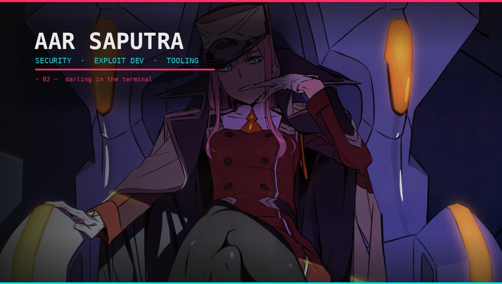
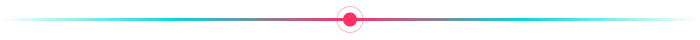

<!-- ===================== ZERO TWO THEME · GitHub Profile README =====================
     Palette: pink neon #FF2E63 · cyan #08D9D6 · bg #0D0D0D · text #EAEAEA
     Copy this file to the root of repo  <username>/<username>  as README.md
=================================================================================== -->

<div align="center">

<!-- HEADER BANNER — Zero Two Anime Wallpaper Banner -->


<!-- TYPING ANIMATION -->
<a href="https://github.com/aarsaputra">
  
</a>

<!-- SOCIAL BADGES -->
<a href="https://github.com/aarsaputra?tab=followers"></a>
<a href="https://github.com/aarsaputra"></a>

</div>

---

### ⚡ About

```python
class Aar:
    name     = "Aar Saputra"
    alias    = "aarsaputra"
    focus    = ["Web Security", "Exploit Dev", "Security Tooling"]
    stack    = ["Python", "PHP", "JavaScript", "HTML5", "CSS3"]
    platform = ["Kali Linux", "Linux"]
    motto    = "Break it to fix it — ethically, and only with permission."
```

- 🔭 Building security tooling & PoC research
- 🌱 Currently deeper into **web exploitation & automation**
- ⚠️ All offensive tools are for **authorized testing / education** only
- 💬 Ask me about **web pentest, Python tooling, CTF**

---

### 🛠️ Tech Stack

<div align="center">


</div>

---

### 🎯 Featured Projects

<div align="center">
<table>
<tr>
<td width="50%" valign="top">

#### 🧨 ppmap-proto-pollution
`⭐ 30` · Python
Prototype Pollution Multi-Purpose Assessment Platform.
<br/><a href="https://github.com/aarsaputra/ppmap-proto-pollution"></a>

</td>
<td width="50%" valign="top">

#### 🎭 MasqOverflow-Suite
`⭐ 6` · Python
Dnsmasq CVE research toolkit (**PoC / research — no RCE claim**).
<br/><a href="https://github.com/aarsaputra/MasqOverflow-Suite"></a>

</td>
</tr>
<tr>
<td width="50%" valign="top">

#### 🛡️ KaliDNS-Switcher
`⭐ 6` · Python
DNS manager for Kali (DoT, leak test, benchmarking).
<br/><a href="https://github.com/aarsaputra/KaliDNS-Switcher"></a>

</td>
<td width="50%" valign="top">

#### 🔍 KarsaSec
`⭐ 3` · Python
Pluggable SAST platform with AST-based CPG engine.
<br/><a href="https://github.com/aarsaputra/KarsaSec"></a>

</td>
</tr>
</table>
</div>

---

### 📊 Stats

<div align="center">


<br/>


</div>

---

<div align="center">



<h3>「 Zero Two — Darling in the Franxx 」</h3>
<sub><i>Offensive security, done responsibly.</i></sub>

</div>
